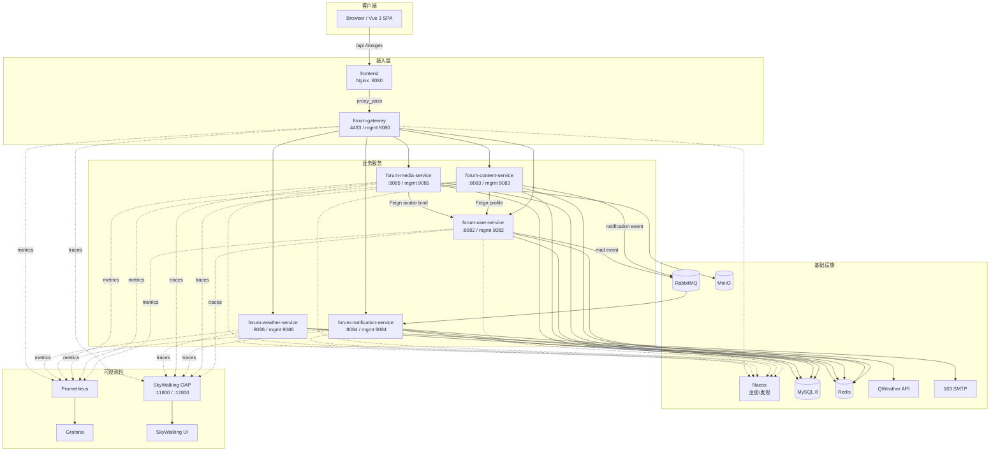
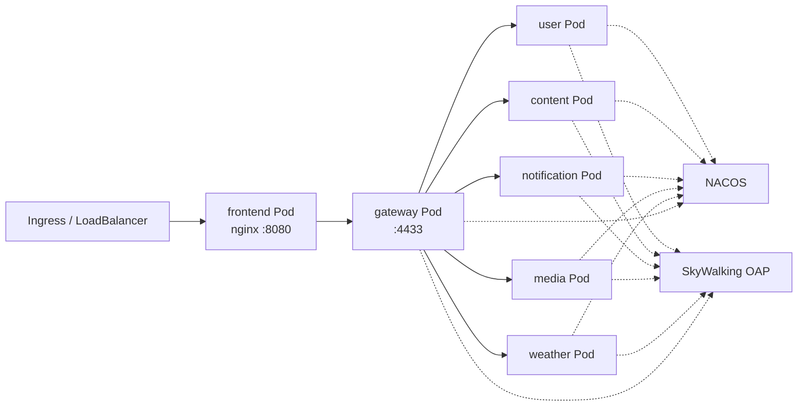

# forum 架构说明（Phase 9）

## 1. 总体架构



## 2. 服务职责

| 服务 | 职责 | 业务端口 | 管理端口 | 数据 |
|---|---|---:|---:|---|
| `frontend` | Vue SPA + Nginx，反代 `/api`、`/images` | 8080 | - | 静态资源 |
| `forum-gateway` | 路由、CORS、JWT 前置校验、Redis 限流 | 4433 | 9080 | Redis |
| `forum-user-service` | 登录/注册、账号、资料、隐私、内部 profile/avatar | 8082 | 9082 | `forum_user` |
| `forum-content-service` | 帖子、类型、评论、点赞/收藏、缓存 | 8083 | 9083 | `forum_content` |
| `forum-notification-service` | 站内通知、邮件、MQ 消费 | 8084 | 9084 | `forum_notification` |
| `forum-media-service` | 图片/头像、MinIO、`/images/**` | 8085 | 9085 | `forum_media` + MinIO |
| `forum-weather-service` | QWeather、Redis 缓存 | 8086 | 9086 | Redis |

## 3. 关键链路

### 登录

```text
Browser → frontend → gateway → user-service
  → MySQL 校验账号
  → BCrypt 校验密码
  → JWT（含 uid/name/role/jti）
  → 返回 token/expire
```

### 帖子详情

```text
Browser → frontend → gateway → content-service
  → forum_content 查帖子
  → Feign /internal/users/{uid}/profile → user-service
  → 返回作者资料 + 互动状态
```

### 发评论 / 通知

```text
Browser → gateway → content-service
  → forum_content 写评论
  → RabbitMQ notification 队列
  → notification-service 消费
  → forum_notification 写入
  → (可选) 邮件队列
```

### 头像上传

```text
Browser → gateway → media-service
  → MinIO 上传 /avatar/...
  → Feign PUT /internal/users/{uid}/avatar → user-service
  → 返回旧头像并清理
```

## 4. K8s 部署视图

> 本阶段只提供 Dockerfile，K8s 清单由部署侧维护。



建议：

- 每个 Deployment 设置 `readinessProbe`/`livenessProbe` 到管理端口 `/actuator/health`；
- 业务端口用 Service 暴露，管理端口只在集群内暴露；
- 配置从 ConfigMap/Secret 注入（数据库、Redis、RabbitMQ、MinIO、SMTP、JWT、QWeather、SkyWalking）；
- `SW_AGENT_COLLECTOR_BACKEND_SERVICES` 指向集群内 SkyWalking OAP Service；
- `SW_AGENT_INSTANCE_NAME` 用 Downward API 注入 Pod 名；
- JVM 内存用 `JAVA_OPTS` 控制，保留 `JAVA_TOOL_OPTIONS` 中的 `-javaagent`。

## 5. 可观测性

- 指标：各服务管理端口 `/actuator/prometheus`，Prometheus 抓取，Grafana 展示；
- 链路：SkyWalking Java Agent 自动埋点 HTTP/Feign/JDBC/Redis/RabbitMQ；
- 日志：容器 stdout，由 K8s 日志采集；
- 告警：`deploy/monitoring/prometheus/rules/forum.yml`。

## 6. 镜像清单

```text
forum-frontend:latest
forum-gateway:latest
forum-user-service:latest
forum-content-service:latest
forum-notification-service:latest
forum-media-service:latest
forum-weather-service:latest
```

构建方式见 `docs/DEPLOYMENT_K8S.md`。
